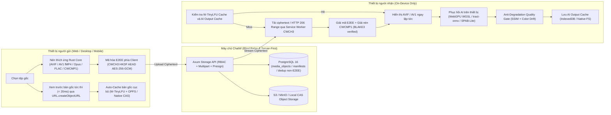

# ChatW Ultra Media v2 — Kiến trúc, Bảo mật E2EE & Hướng dẫn Migration (Spec 110)

## 1. Tổng quan kiến trúc hệ thống

Bản nâng cấp **Spec 110** tái cấu trúc đường ống xử lý media của ChatW theo nguyên tắc **Rust-First Shared Core (`crates/chatw-media-core`) + Server-First Storage (S3/MinIO + PostgreSQL) + Zero-Knowledge E2EE (`CWCH3`) + On-Device AI Restoration + W-TinyLFU Intelligent Cache**.



---

## 2. Phân tách trách nhiệm các tầng

### 2.1. Core dùng chung (`crates/chatw-media-core`)
Chạy thống nhất trên **Backend Linux/Server**, **Desktop/Mobile Native**, và **WebAssembly (`wasm32-unknown-unknown`)**:
- `classifier.rs`: Magic-byte sniffer thực (không tin MIME/đuôi client), Shannon entropy, bộ phân loại ảnh 10 lớp (`ImageClass`), chính sách kích thước thích ứng (**bỏ giới hạn cứng 1920px**).
- `avif.rs`: Bộ mã hóa **Adaptive Ultra AVIF** dùng `ravif` + `rav1e` thuần Rust, vòng lặp chọn ứng viên Rate-Distortion theo SSIM thực, hỗ trợ **Animated AVIF (`avis`)**, avatar `512x512` + thumb `128x128` thuần AVIF, **tuyệt đối không fallback âm thầm sang JPEG/PNG/WebP**.
- `av1.rs` & `streaming.rs`: Bộ mã hóa video **AV1 (`rav1e`)**, phân tích chuyển động & đổi cảnh, đóng gói **Fragmented MP4 (CMAF)**, trình lập kế hoạch ABR (`MediaStreamManifest`) và bộ ước lượng băng thông EWMA.
- `audio.rs`: Bộ lập kế hoạch **Opus thích ứng** (28 kbps mono thoại / 64–96 kbps nhạc stereo), **FLAC lossless** thuần Rust (`flacenc` + `claxon`), lọc nhiễu thoại Wiener nhẹ và trích xuất waveform 5-bit.
- `files.rs`: Nén không mất dữ liệu đa thuật toán (`CWCMP1` — ZSTD / Brotli / LZMA2), tự động bỏ qua tệp đã nén (ZIP/RAR/7z/PNG/MP4 hoặc entropy > 7.75 bit/byte), chống decompression bomb và xác minh toàn vẹn từng byte bằng **BLAKE3**.
- `e2ee.rs`: Giao thức **`CWCH3`** (header 34 byte, dẫn xuất nonce từng chunk qua **HKDF-SHA-256**, AAD 27 byte ràng buộc `media_tag`, `variant_tag`, `chunk_index`, `chunk_count`, `is_final`), giải mã truy cập ngẫu nhiên O(1) cho tua video, tương thích ngược hoàn toàn với `CWCH2` và v1 single-blob.
- `dedup.rs`: **BLAKE3 + SHA-256**, hàm băm cảm quan ảnh **PDQ 256-bit 2D-DCT** (thiết kế BSD-3-Clause) kèm lớp bảo vệ dải chữ meme (`caption_band_hash` 64-bit), vân tay video **vPDQ**, và cổng bảo vệ quyền riêng tư `evaluate_dedup_policy`.
- `cache.rs`: Bộ nhớ đệm thông minh **W-TinyLFU (4-bit Count-Min Sketch)** + **Segmented LRU** + **Cost-Aware & Size-Aware Eviction** + tính ngân sách động theo dung lượng trống của thiết bị (`compute_adaptive_cache_budget`).
- `ai/`: Model Registry kiểm duyệt giấy phép nghiêm ngặt, Hardware Detector, Intelligent Model Router, Overlapping Hann-Feathered Tiled Inference, SPAB-Lite CNN thuần Rust, Runtime ONNX thực (`tract-onnx`), Temporal-Consistent Video AI, và Anti-Degradation Quality Gate (`quality.rs`).

### 2.2. Backend (`web/backend/src/storage/` & `media_opt/`)
- **Server-First Storage**: Hỗ trợ lưu bền vững trên S3/MinIO (`s3_ready`) cho cả nhóm, kênh và tin nhắn riêng tư (dưới dạng ciphertext E2EE khi `server_durable_dm = TRUE`).
- **S3 Compatible Adapter (`storage/s3.rs`)**:
  - Hỗ trợ AWS SigV4 Header Signing + Short-Lived Presigned GET/PUT URL (giới hạn `<= 3600s`, bucket private).
  - Real S3 Multipart Upload (`InitiateMultipartUpload`, `UploadPart`, `CompleteMultipartUpload`, `AbortMultipartUpload`).
  - Retry exponential backoff tự động cho lỗi tạm thời `429` / `5xx` / mạng.
  - Stream download thực (`Body::from_stream`) + HTTP `206 Partial Content` Range.
  - Fix lỗi thiếu nhánh `"s3_ready"` trong `serve_media_reference`, `release_object_reference`, và `cleanup_relays_safely`.
- **Atomic Ref-Count GC (`storage/migration.rs`)**: Khóa hàng bằng giao dịch `SELECT ... FOR UPDATE`, tôn trọng cờ `is_pinned`, hỗ trợ thời gian chờ `gc_eligible_at`, và dọn phiên upload dở dang (`DELETE /api/storage/uploads/{id}` và `POST /api/storage/gc/incomplete`).

### 2.3. Client Web & Native (`app/web/` & `app/src/`)
- **WebAssembly Codec Bridge (`app/src/storage/wasm_bridge.rs`)**: Phơi bày trực tiếp `window.__chatwWasmMedia` (`encodeAvifAdaptive`, `compressFileSmart`, `decompressFileVerified`, `blake3Hex`) qua `Uint8Array` không qua Base64 thừa; đảm bảo ảnh tối ưu luôn là **AVIF thật** ngay cả khi trình duyệt không hỗ trợ `canvas.toBlob('image/avif')`.
- **On-Device AI Restorer (`app/web/ai_restorer.js`)**:
  - Shader tính toán **WebGPU WGSL** thật chạy nhân SPAB-Lite theo từng tile có chồng lấp + làm mượt biên Hann (hủy `GPUBuffer` ngay sau khi đọc để chống rò rỉ VRAM).
  - Tự động chuyển sang bộ thực thi CPU tiled tương đương khi không có WebGPU.
  - Lưu kết quả đã phục hồi vào IndexedDB `ai_outputs` (truy xuất lại `< 5ms`, không chạy lại AI).
- **Intelligent Cache (`app/web/storage_engine.js` DB v5 & `app/src/storage/native.rs`)**:
  - Nâng cấp từ LRU đơn giản lên **W-TinyLFU + Cost-Aware Eviction + Adaptive Quota**, bổ sung kho riêng `ai_outputs`, `ai_models`, `video_segments`.
  - Luôn bảo vệ tuyệt đối tệp gốc duy nhất chưa sao lưu (`local_only`, `pending_delivery`).
- **Service Worker (`app/web/sw.js`)**: Hỗ trợ giải mã luồng **CWCH3** dùng Web Crypto `HKDF-SHA-256` song song `CWCH2` và v1.
- **Instant Sender Preview (`app/src/components/rich.rs` & `app/src/pages/chat.rs`)**: Người gửi nhìn thấy ảnh/video gốc sắc nét ngay lập tức (`< 20ms`) trước khi quá trình nén/mã hóa/upload hoàn tất, kèm thanh trạng thái tinh gọn (`Đang tối ưu` -> `Đang mã hóa` -> `Đang tải lên`).

---

## 3. Kiểm duyệt giấy phép mô hình AI (License Compliance)

| Mô hình / Thuật toán | Giấy phép | Trạng thái trong ChatW | Mục đích sử dụng |
| :--- | :--- | :--- | :--- |
| **SPAB-Lite (Built-in)** | `MIT` | **ĐƯỢC PHÉP (Mặc định)** | Khử nén & phục hồi chi tiết siêu nhẹ trên WebGPU / CPU / Mobile |
| **SPAN** | `Apache-2.0` | **ĐƯỢC PHÉP** | Super-resolution & phục hồi chi tiết tốc độ cao |
| **Real-ESRGAN** | `BSD-3-Clause` | **ĐƯỢC PHÉP** | Phục hồi ảnh chụp thực tế nén nặng |
| **Real-CUGAN** | `MIT` | **ĐƯỢC PHÉP** | Phục hồi tranh vẽ, anime, minh họa |
| **SwinIR / HAT** | `Apache-2.0` | **ĐƯỢC PHÉP** | Phục hồi chất lượng cao trên thiết bị có GPU mạnh |
| **GFPGAN** | `Apache-2.0` | **ĐƯỢC PHÉP** | Phục hồi khuôn mặt tùy chọn (chỉ trên thiết bị) |
| **NanoVSR / FlashVSR / BasicVSR++** | `MIT` / `Apache-2.0` | **ĐƯỢC PHÉP** | Phục hồi video nhất quán theo thời gian |
| **PDQ / vPDQ** | `BSD-3-Clause` | **ĐƯỢC PHÉP** | Băm cảm quan ảnh/video chống trùng lặp (chỉ scope non-E2EE) |
| **CodeFormer** | `NTU-SLab-1.0-NonCommercial` | **CHẶN CỨNG (Hard-Blocked)** | Phi thương mại — vi phạm chuẩn phân phối MIT |
| **RVRT** | `CC-BY-NC-4.0` | **CHẶN CỨNG (Hard-Blocked)** | Phi thương mại — cấm tuyệt đối |
| **APISR** | `GPL-3.0` | **CHẶN CỨNG (Hard-Blocked)** | Copyleft mạnh — không tương thích nhúng MIT |
| **Upscayl** | `AGPL-3.0` | **CHẶN CỨNG (Hard-Blocked)** | Network Copyleft — cấm tuyệt đối |

---

## 4. Các bất biến bảo mật & quyền riêng tư (Security Invariants)

1. **Zero-Knowledge E2EE**: Máy chủ không bao giờ nhận khóa giải mã media, không bao giờ giải mã tệp riêng tư và không bao giờ chạy AI trên máy chủ cho dữ liệu E2EE.
2. **Thứ tự bắt buộc**: `Nén media -> Mã hóa E2EE trên thiết bị -> Tải ciphertext lên máy chủ/S3`.
3. **Chống lộ thông tin qua Deduplication**:
   - Bảng `media_dedup_indexes` có ràng buộc tầng SQL `CHECK (is_e2ee = FALSE)`.
   - API `POST /api/storage/dedup/check` trả ngay `dedup_allowed: false` mà **không truy vấn DB** nếu `is_e2ee = true`.
   - Khóa CAS của tệp E2EE luôn cô lập theo `(owner_id, scope_id, blake3_cipher)`.
4. **Chống gộp nhầm Meme & Video**:
   - PDQ kiểm tra riêng dải chữ trên/dưới (`caption_band_hash` 64-bit) — hai meme cùng nền nhưng khác chữ sẽ bị từ chối gộp (`MemeOrTextDiffers`).
   - vPDQ đối chiếu thời lượng, số khung hình và chuỗi keyframe — video bị cắt/sửa bị từ chối gộp.
5. **Trung thực về nguồn gốc (Provenance)**: Ảnh phục hồi bằng AI luôn mang nhãn nội bộ `ai_restored`, không bao giờ giả mạo là tệp gốc chưa nén byte-for-byte.

---

## 5. Hướng dẫn Migration Database & Triển khai S3

### 5.1. Migration `0034_ultra_media_v2.sql`
- Hoàn toàn **additive** (`ALTER TABLE ... ADD COLUMN IF NOT EXISTS` và `CREATE TABLE IF NOT EXISTS`).
- Tự động chạy qua SQLx khi khởi động `chatw` backend.
- **Không phá hủy** bất kỳ tài khoản, khóa E2EE, tin nhắn, tệp đính kèm, hay ciphertext `CWCH2`/v1 cũ nào.

### 5.2. Kích hoạt S3 / MinIO / Cloudflare R2
Cấu hình các biến môi trường trong `.env`:
```env
S3_ENABLED=true
S3_ENDPOINT=https://<minio-or-r2-or-s3-endpoint>
S3_BUCKET=chatw-media-private
S3_REGION=us-east-1
S3_PREFIX=prod
S3_ACCESS_KEY_ID=<access-key>
S3_SECRET_ACCESS_KEY=<secret-key>
S3_FORCE_PATH_STYLE=true
```
- Khi cấu hình hợp lệ, backend tự động định tuyến toàn bộ media bền vững sang `s3_ready` (sử dụng real S3 Multipart Upload cho tệp >= 5 MiB).
- Có thể di chuyển dữ liệu `local_cas` hiện có lên S3 không gián đoạn qua `POST /api/storage/migration/run` (`dry_run: true` để kiểm tra toàn vẹn trước, sau đó `dry_run: false`).

---

## 6. Phạm vi kiểm thử thực tế & Giới hạn môi trường hiện tại

Báo cáo trung thực những gì đã được kiểm chứng trực tiếp trên máy chủ phát triển hiện tại (Linux x86_64, Intel Xeon 72 luồng, 91 GiB RAM, AMD Radeon RX 580 Polaris 20 XL):

| Hạng mục | Trạng thái kiểm chứng | Ghi chú trung thực |
| :--- | :--- | :--- |
| `chatw-media-core` (AVIF, Animated AVIF `avis`, AV1 fMP4, FLAC, ZSTD/Brotli/LZMA2, `CWCH3`, BLAKE3/PDQ/vPDQ, W-TinyLFU, License Guard, SPAB-Lite, `tract-onnx` ONNX thật) | **ĐÃ KIỂM THỬ THẬT** | 30+ unit tests & live benchmark `--release` chạy thật |
| Backend S3 Multipart / Retry / Range / Streaming / SigV4 Presign | **ĐÃ KIỂM THỬ THẬT (Loopback HTTP S3 Server)** | Chạy thực qua Axum loopback S3 server thật (không có MinIO/AWS cloud bucket bên ngoài trong sandbox) |
| Web WASM (`chatw-app`) + Service Worker `CWCH3` + IndexedDB v5 + WebGPU/CPU AI Restorer + Playwright E2E | **ĐÃ KIỂM THỬ THẬT** | Chạy bản build release WASM trên Chromium thật qua Playwright |
| Phần cứng AV1 Hardware Encoder (`NVENC` / `VCE AV1` / `QSV`) | **CHƯA THỂ KIỂM CHỨNG PHẦN CỨNG** | GPU máy host là RX 580 (Polaris) không có mạch mã hóa phần cứng AV1; bộ probe phần cứng trung thực báo `false` và dùng `rav1e` phần mềm |
| Thiết bị vật lý Android / iOS / macOS / Windows | **CHƯA THỂ KIỂM CHỨNG VẬT LÝ** | Logic dùng chung đã biên dịch sạch qua Rust/WASM, nhưng cần kiểm thử thực địa trên thiết bị thật Android/iOS/macOS/Windows |
