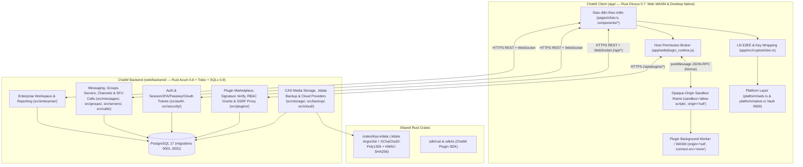

# Kiến trúc Hệ thống, Bảo mật E2EE & Cô lập Plugin Sandbox của ChatW

Tài liệu này mô tả chính xác kiến trúc thực tế đang vận hành trong mã nguồn ChatW (`https://github.com/kiyogo/chart`).

---

## 1. Sơ đồ Kiến trúc Thực tế (Modular Monolith)

---

## 2. Ranh giới Bảo mật & Luồng Dữ liệu

### 2.1. Luồng Tin nhắn E2EE & Bảo vệ Khóa tại chỗ (At-Rest Key Protection)
1. **Sinh & Lưu khóa**:
   - Mỗi tài khoản người dùng sở hữu cặp khóa riêng biệt `chatw_e2ee_keys_<user_id>` (ECDH P-256 + ECDSA P-256). Tuyệt đối không dùng chung khóa giữa các tài khoản trên cùng thiết bị.
   - Khi lưu xuống đĩa hoặc trình duyệt, khóa riêng tư được mã hóa bằng **AES-256-GCM** (`enc:v1:<nonce>:<ciphertext>` với khóa bọc thiết bị dẫn xuất qua `HKDF-SHA256`; trên Desktop tệp `client_storage.json` được bọc thêm lớp `vault:v1:` bằng khóa chủ `.vault.key` có quyền hệ điều hành `0600`).
   - **Tương thích ngược không mất dữ liệu**: Khi đọc khóa định dạng JSON văn bản thuần từ các phiên bản cũ, `get_user_keys()` tự động giải mã, nạp khóa vào bộ nhớ và nâng cấp tại chỗ sang định dạng mã hóa `enc:v1:` mà không làm mất bất kỳ tin nhắn cũ nào.
2. **Truyền tải**:
   - Bản rõ được mã hóa `AES-256-GCM` với khóa phiên tạm thời dẫn xuất từ `ECDH(ephemeral_sk, recipient_pk)` + `HKDF-SHA256("chatw-v1-msg:<msg_id>")` và gắn chữ ký `ECDSA P-256` trên toàn bộ phong bì (`aad || ephemeral_pub || salt || nonce || ciphertext`).
   - Máy chủ PostgreSQL chỉ lưu bản mã (`recipient_envelope`, `sender_envelope`) và không bao giờ có khóa riêng tư.

### 2.2. Luồng Thực thi Plugin Cô lập (`origin = "null"`)
1. **Không chạy cùng Origin với Host**:
   - Khi một Plugin được bật, `app/web/plugin_runtime.js` tạo một `<iframe sandbox="allow-scripts">` ẩn trỏ tới `/plugin-sandbox-frame#<nonce>`.
   - Tuyến `/plugin-sandbox-frame` trả về CSP khóa chặt:
     `default-src 'none'; script-src 'unsafe-inline' 'unsafe-eval' 'wasm-unsafe-eval' blob:; worker-src blob:; connect-src 'none';`
   - Bên trong iframe có `origin === "null"` này, Blob Web Worker (chạy JS/TS bundle hoặc nhị phân Rust `.wasm`) mới được khởi tạo.
   - Nhờ đó, Worker cũng mang `origin === "null"` và chịu CSP `connect-src 'none'`: mọi nỗ lực gọi trực tiếp `fetch('/api/...')`, `XMLHttpRequest`, `WebSocket`, hoặc truy cập `document.cookie` / `localStorage` đều bị trình duyệt chặn đứng ở mức engine.
2. **Kiểm soát Tài nguyên & Vòng đời**:
   - Giới hạn bộ nhớ tuyến tính WebAssembly (`max_memory_mb`), giới hạn hàng đợi lệnh gọi đồng thời (`MAX_PENDING_INVOKES = 64`), thời gian khởi động tối đa (`5000ms`) và thời gian thực thi mỗi lời gọi (`max_exec_ms`, mặc định `3000ms`).
   - Khi một Plugin treo hoặc lặp vô hạn (`while(true){}`), bộ đếm thời gian của Host lập tức hủy iframe và worker (`worker.terminate()`), chuyển trạng thái sang `timeout_killed` mà không làm đơ giao diện ChatW.

### 2.3. Mô hình Quyền Plugin 4 Lớp & Chống Rò rỉ E2EE
1. **Bốn lớp kiểm soát tách biệt**:
   - **Lớp 1 — Xác minh Nhà phát triển & Chữ ký số**: Nhà phát triển có thể đăng ký khóa công khai ECDSA P-256 (`public_key`) và ký số gói Plugin (`chatw-plugin-sig-v1:<plugin_key>:<version>:<sha256>`). Các quyền `e2ee.*` bắt buộc nhà phát triển phải đạt trạng thái `verified`.
   - **Lớp 2 — Phê duyệt Quyền Nhạy cảm theo Phiên bản**: Dấu tích xanh của nhà phát triển không tự động cấp quyền nhạy cảm; mỗi phiên bản yêu cầu quyền nhạy cảm phải có `sensitive_approval_status = "approved"`. Khi nâng cấp phiên bản, nếu phiên bản mới yêu cầu thêm quyền nhạy cảm, hệ thống chặn nâng cấp im lặng (`update_requires_new_permission_consent`).
   - **Lớp 3 — Tách biệt Chủ thể Cấp quyền (`user_id`) và Phạm vi Cài đặt (`scope_type`)**: Các quyền cá nhân (`profile.read`, `contacts.read`, `contacts.write`, `e2ee.*`) luôn gắn chặt với `user_id` của chính người cấp. Quản trị viên máy chủ/nhóm hoặc thành viên A không bao giờ có thể cấp quyền đọc hồ sơ, danh bạ hay tin nhắn E2EE của thành viên B.
   - **Lớp 4 — Kiểm soát Rò rỉ E2EE ở cả Client và Server**: Khi một phiên Plugin có quyền `e2ee.read_decrypted` hoặc `e2ee.process_local` (hoặc đã ghi nhận hành động `e2ee_read` trong `plugin_audit_logs`), máy chủ tự động đánh dấu phiên đó là `server_e2ee_tainted = true` và chặn mọi yêu cầu `POST /api/plugins/installations/{id}/net/fetch` trừ khi người dùng đó đã cấp tường minh quyền `e2ee.egress_external` (hoặc `e2ee.store_external`).
