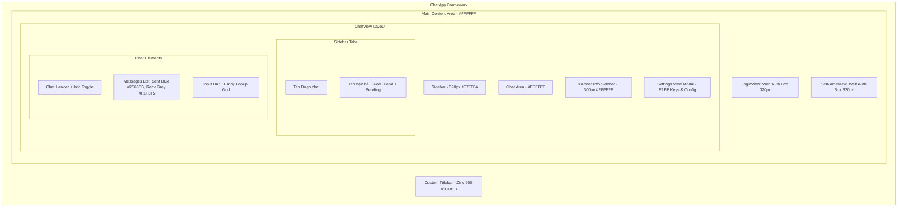

# Kế hoạch Kỹ thuật: Đồng bộ giao diện Native Rust Client 100% khớp Web

## 1. Kiến trúc Giao diện & Thành phần

## 2. Mô hình Dữ liệu & Mở rộng Trạng thái
- `crates/chatw-client/src/views/chat.rs`:
  - Thêm `sidebar_tab: SidebarTab` (`Chats`, `Friends`).
  - Thêm `is_partner_info_open: bool` (mặc định mở trên màn hình rộng).
  - Thêm `is_settings_open: bool` (mở bảng cài đặt tài khoản & E2EE).
  - Thêm `is_emoji_popup_open: bool` (popup chọn emoji dạng lưới).
  - Thêm `last_previews: HashMap<Uuid, String>` (lưu trữ tin nhắn mới nhất hiển thị dưới tên bạn bè ở tab Đoạn chat).
  - Mở rộng các `ChatAction` tương ứng.
- `crates/chatw-client/src/views/login.rs`:
  - Đồng bộ màu sắc `#FFFFFF`, card 320px, icon Google đa sắc, viền `#E5E7EB`.
- `crates/chatw-client/src/views/set_name.rs`:
  - Đồng bộ phong cách thẻ nhập tên người dùng theo đúng bản web.
- `crates/chatw-client/src/app.rs`:
  - Cập nhật Visuals của egui sang Light Minimalist:
    - `panel_fill`: `#FFFFFF`
    - `widgets.noninteractive.bg_fill`: `#F7F8FA`
    - `widgets.inactive.bg_fill`: `#F7F8FA`
    - `widgets.hovered.bg_fill`: `#ECEEF2`
    - `widgets.active.bg_fill`: `#2563EB`
    - Text primary: `#171717`, secondary: `#737373`.

## 3. Danh sách File cần Chỉnh sửa
1. `crates/chatw-client/src/app.rs`: Cấu hình theme egui Visuals, kết nối sự kiện Settings, Partner Info.
2. `crates/chatw-client/src/views/chat.rs`: Tái cấu trúc toàn diện layout 3 cột: Sidebar (Tabs Chats/Friends) + Chat Area (Header/Messages/Input/Emoji) + Partner Info Panel + Settings Modal.
3. `crates/chatw-client/src/views/login.rs`: Cập nhật layout, màu sắc và nút đăng nhập giống 100% web.
4. `crates/chatw-client/src/views/set_name.rs`: Cập nhật màu sắc và layout theo chuẩn web.
5. `crates/chatw-client/src/titlebar.rs`: Tinh chỉnh tỷ lệ và biểu tượng thanh tiêu đề tối Windows đồng bộ.
