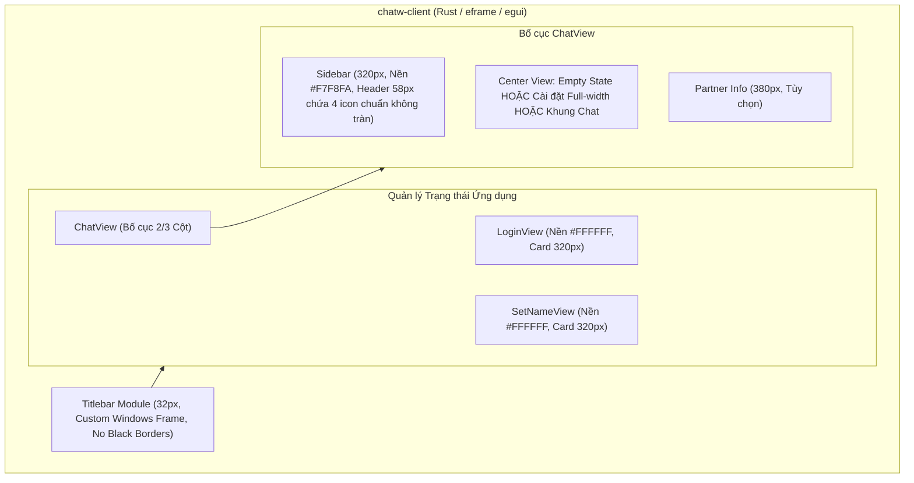

# Kế hoạch Kỹ thuật: Viết lại Giao diện Native Rust (.rs) Khớp 100% Web

## 1. Kiến trúc Hệ thống

---

## 2. Các Tệp Cần Chỉnh sửa & Tái cấu trúc

1. **`crates/chatw-client/src/main.rs`**:
   - Tinh chỉnh `NativeOptions` và `ViewportBuilder` để loại bỏ hoàn toàn viền đen viền ngoài khi không dùng trang trí mặc định.
   - Bảo đảm kích thước cửa sổ khởi tạo và tỷ lệ DPI sắc nét.

2. **`crates/chatw-client/src/app.rs`**:
   - Thiết lập `egui::Visuals` ánh xạ chính xác biến CSS Web:
     - `panel_fill`: `#FFFFFF`
     - `faint_bg_color`: `#F7F8FA`
     - `extreme_bg_color`: `#FFFFFF`
     - `widgets.noninteractive.bg_fill`: `#F7F8FA`
     - `widgets.inactive.bg_fill`: `#F7F8FA`
     - `widgets.hovered.bg_fill`: `#ECEEF2`
     - `widgets.active.bg_fill`: `#2563EB`
   - Chuẩn hóa bộ nạp font tiếng Việt Segoe UI Regular, Segoe UI Semibold và Arial đảm bảo hiển thị rõ ràng, sắc nét.

3. **`crates/chatw-client/src/titlebar.rs`**:
   - Hoàn thiện các hàm vẽ Vector SVG: `draw_svg_logo_icon`, `draw_svg_friends_icon`, `draw_svg_settings_icon`, `draw_svg_logout_icon`, `draw_svg_send_icon`, `draw_svg_back_icon`, `draw_svg_menu_icon`, `draw_svg_close_icon`.
   - Chuẩn hóa layout titlebar 32px với 3 nút điều khiển Windows góc phải.

4. **`crates/chatw-client/src/views/login.rs`**:
   - Thiết kế card đăng nhập 320px chính giữa màn hình.
   - Loại bỏ chuỗi ba chấm `...`.
   - Nút Google xanh với icon SVG đa sắc Google.

5. **`crates/chatw-client/src/views/chat.rs`**:
   - **Sidebar Header**: Avatar 28px + Tên người dùng bên trái (chiếm tối đa 118px); 4 nút icon kích thước 34x34 cách nhau 4px bên phải (tổng 148px), vừa khít chiều rộng 288px (320px - 32px padding), loại bỏ hoàn toàn hiện tượng icon đăng xuất bị cắt xẻng.
   - **Sidebar Tabs**:
     - `chats`: Danh sách bạn bè kèm avatar tròn 38px, tên và preview tin nhắn. Trạng thái rỗng: "Chưa có bạn bè nào".
     - `friends`: Form nhập "Tên tài khoản" + Nút "Kết bạn", danh sách yêu cầu kết bạn. Trạng thái rỗng: "Không có lời mời nào".
   - **Khu vực Trò chuyện Chính**:
     - Trạng thái rỗng: "Chọn một cuộc trò chuyện để bắt đầu".
     - Trạng thái Cài đặt: Mở tràn toàn bộ khu vực chính, có nút quay lại `←`, thẻ hồ sơ cá nhân và các mục E2EE.
     - Trạng thái Chat:
       - Header 54px với Avatar 34px và tên bạn bè.
       - Vùng tin nhắn: Tin gửi màu xanh `#2563EB`, tin nhận màu xám `#F1F3F5` kèm avatar đối tác 28px.
       - Thanh nhập tin nhắn 60px ghim chặt dưới đáy, có nút Emoji và nút gửi máy bay giấy.

6. **Biên dịch Release & Kịch bản Khởi động**:
   - Biên dịch `cargo build --release -p chatw-client`.
   - Sao chép tệp thực thi sang `dist-desktop/chatw.exe`.
   - Cập nhật `run-desktop.bat` và `start-all.bat` khởi chạy `dist-desktop/chatw.exe`.
